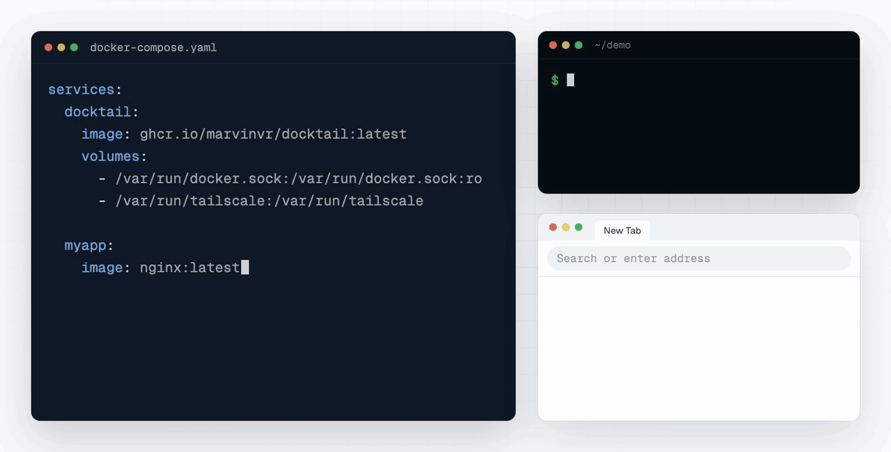

# 🍸 DockTail

**Unleash your containers as Tailscale Services.**

<p>
  <a href="https://github.com/marvinvr/docktail/releases/latest"></a>
  <a href="LICENSE"></a>
  <a href="https://github.com/marvinvr/docktail/pkgs/container/docktail"></a>
  <a href="https://github.com/marvinvr/docktail/actions/workflows/ci.yaml"></a>
</p>

<p align="center">
  
</p>

<p align="center">
  <a href="https://tailscale.com/community/community-projects/docktail">
    
  </a>
</p>

DockTail watches Docker containers, reads `docktail.*` labels, and exposes matching containers as Tailscale Services. App containers do not need published Docker ports by default; DockTail proxies directly to their Docker network IPs.

## Why DockTail?

DockTail uses native Tailscale Services, not per-container Tailscale devices.

| | DockTail | TSDProxy | ScaleTail | tsbridge | Plain Services |
|---|---:|---:|---:|---:|---:|
| Native Tailscale Services | ✅ | ❌ | ❌ | ❌ | ✅ |
| Configured via Docker labels | ✅ | ✅ | ❌ | ✅ | ❌ |
| Apps do not consume separate Tailscale device slots | ✅ | ❌ | ❌ | ❌ | ✅ |
| No app port publishing | ✅ | ⚠️¹ | ⚠️² | ⚠️¹ | ⚠️³ |
| Automatic Docker reconciliation | ✅ | ✅ | ❌ | ✅ | ❌ |
| Low manual setup after install | ✅ | ✅ | ⚠️⁴ | ✅ | ❌ |

- ¹ Depends on proxy and Docker network setup.
- ² Depends on the sidecar template and app network setup.
- ³ You configure how the service host reaches the backend yourself.
- ⁴ ScaleTail is template-based, so each app usually starts from its own Compose recipe.

## Features

- Automatic Docker container discovery through labels.
- Automatic Tailscale service creation with OAuth or API key credentials.
- HTTP, HTTPS, TCP, and TLS-terminated TCP support.
- Optional PROXY protocol on TCP services so backends see the tailnet client IP.
- Tailscale HTTPS with automatic certificates.
- Tailscale Funnel for public internet access.
- Multiple Tailscale services from one container.
- Automatic reconciliation when containers restart or IPs change.
- Optional cleanup of unused Tailscale service definitions (opt-in, safe with multiple instances).
- Stateless Docker container runtime.
- Optional [DockTail Cloud](https://docktail.org/cloud/) reporting — multi-host monitoring, opt-in via one env var.

## Before you start

- [ ] The Docker host is on your tailnet and tagged `tag:server` (`sudo tailscale up --advertise-tags=tag:server --reset`). On macOS, Windows and many NAS devices, use the [Tailscale sidecar](docs/02-installation.md#tailscale-sidecar) instead.
- [ ] Your tailnet policy lists `tag:server` and `tag:container` (the default service tag) in `tagOwners`, and `autoApprovers.services` lets `tag:server` advertise `tag:container` services.
- [ ] Recommended: a Tailscale OAuth client for `tag:server` with **Services: Write** and **Devices Core: Write** (plus **Keys Auth Keys: Write** for the sidecar). No broader scope, such as `all`, is needed. Without credentials, you create each service in the admin console yourself. See [OAuth Credentials](docs/03-tailscale-admin.md#oauth-credentials).

<details>
<summary>Policy snippet (tagOwners + autoApprovers)</summary>

```json
{
  "tagOwners": {
    "tag:server": ["autogroup:admin"],
    "tag:container": ["tag:server"]
  },
  "autoApprovers": {
    "services": {
      "tag:container": ["tag:server"]
    }
  }
}
```

</details>

## Quick Start

```yaml
services:
  docktail:
    image: ghcr.io/marvinvr/docktail:latest
    restart: unless-stopped
    volumes:
      - /var/run/docker.sock:/var/run/docker.sock:ro
      - /var/run/tailscale:/var/run/tailscale
    environment:
      # Optional but recommended. Enables automatic service creation.
      - TAILSCALE_OAUTH_CLIENT_ID=${TAILSCALE_OAUTH_CLIENT_ID}
      - TAILSCALE_OAUTH_CLIENT_SECRET=${TAILSCALE_OAUTH_CLIENT_SECRET}

  myapp:
    image: nginx:latest
    # No ports needed. DockTail proxies directly to the container IP.
    labels:
      - "docktail.service.enable=true"
      - "docktail.service.name=myapp"
      - "docktail.service.port=80"
```

```bash
docker compose up -d
curl http://myapp.your-tailnet.ts.net
```

This assumes the Docker host is connected to Tailscale and allowed to advertise services. See the full docs for host setup, sidecar setup, rootless Docker, OAuth permissions, ACLs, labels, Funnel, and examples. [`docker-compose.yaml`](docker-compose.yaml) is a ready-to-run version of this setup; for Podman, Synology, Unraid, TrueNAS, macOS, Windows, Swarm and Kubernetes see the [platform guides](docs/02-platforms.md), and for a read-only Docker socket proxy and dropped capabilities see [Hardening](docs/02-security.md).

For Docker secrets or other mounted secret files, set `FILE__TAILSCALE_OAUTH_CLIENT_ID` / `FILE__TAILSCALE_OAUTH_CLIENT_SECRET` or `TAILSCALE_OAUTH_CLIENT_ID_FILE` / `TAILSCALE_OAUTH_CLIENT_SECRET_FILE` to the mounted file paths instead of putting the values directly in the environment.

## Common Examples

Expose an app with Tailscale HTTPS:

```yaml
labels:
  - "docktail.service.enable=true"
  - "docktail.service.name=api"
  - "docktail.service.port=3000"
  - "docktail.service.service-port=443"
```

Expose a database over TCP:

```yaml
labels:
  - "docktail.service.enable=true"
  - "docktail.service.name=db"
  - "docktail.service.port=5432"
  - "docktail.service.protocol=tcp"
  - "docktail.service.service-port=5432"
```

Preserve the tailnet client IP on a TCP reverse proxy:

```yaml
labels:
  - "docktail.service.enable=true"
  - "docktail.service.name=traefik"
  - "docktail.service.port=443"
  - "docktail.service.protocol=tcp"
  - "docktail.service.service-port=443"
  - "docktail.service.proxy-protocol=2"
```

Expose a service publicly with Tailscale Funnel:

```yaml
labels:
  - "docktail.funnel.enable=true"
  - "docktail.funnel.port=3000"
  - "docktail.funnel.funnel-port=8443"
```

Mount an HTTP(S) Funnel at a path:

```yaml
labels:
  - "docktail.funnel.enable=true"
  - "docktail.funnel.port=3000"
  - "docktail.funnel.path=/webhook"
```

## DockTail Cloud (optional)

Once you run DockTail on more than one machine, "is it still up?" gets tedious. [DockTail Cloud](https://docktail.org/cloud/) is a hosted dashboard for that — and because it already has the Docker and Tailscale context, it tells you *which* kind of broken you're looking at:

```text
● down · OOM-killed                   →  the container was killed for running out of memory
● local up · awaiting approval        →  the app is fine, the exposure isn't
● host offline · heartbeat missing    →  the box stopped reporting
```

It rides along with the agent you already run — no second binary. Set one environment variable and the same container starts reporting:

```yaml
environment:
  - DOCKTAIL_CLOUD_KEY=${DOCKTAIL_CLOUD_KEY}   # from cloud.docktail.org
```

Without the key the module is completely inert: no connection is opened and DockTail behaves exactly as before. The link is outbound-only and metadata-only — the protocol has no exec, deploy, or shell message types, which you can verify in [`cloud/`](cloud/).

DockTail Cloud is a paid service ([plans and pricing](https://docktail.org/cloud/#pricing)); Homelab and Team start with a 30-day free trial. Your AI agent can investigate incidents through its [MCP server and API](https://docktail.org/cloud/agents/). [`docker-compose.cloud.yaml`](docker-compose.cloud.yaml) is a complete example.

[Explore DockTail Cloud](https://docktail.org/cloud/) · [open the dashboard](https://cloud.docktail.org/login) · [agent setup](docs/06-cloud.md)

## Documentation

- Human docs: https://docktail.org/docs/
- Markdown docs: https://docktail.org/docs.md
- LLM guide: https://docktail.org/llms.txt
- Full LLM docs: https://docktail.org/llms-full.txt

- DockTail Cloud overview: https://docktail.org/cloud/
- Optional Cloud agent setup: [`docs/06-cloud.md`](docs/06-cloud.md)

The canonical documentation source lives in [`docs/`](docs/). The site at
docktail.org is built from a separate repository, which pins this one as a
submodule and renders those Markdown files with `tools/docsgen` at build time.

## Build From Source

```bash
go build -o docktail .
docker build -t docktail:latest .
```

The image is published for `linux/amd64`, `linux/arm64` and `linux/arm/v7`, and [releases](https://github.com/marvinvr/docktail/releases) newer than 1.8.3 carry static Linux binaries for the same platforms; see [Platforms And Release Binaries](docs/02-installation.md#platforms-and-release-binaries).

## Links

- [Tailscale Services Documentation](https://tailscale.com/kb/1552/tailscale-services)
- [Tailscale Funnel Documentation](https://tailscale.com/kb/1311/tailscale-funnel)
- [Tailscale Service Configuration Reference](https://tailscale.com/kb/1589/tailscale-services-configuration-file)
- [Docker SDK for Go](https://docs.docker.com/engine/api/sdk/)

## Star History

<a href="https://www.star-history.com/?type=date&legend=top-left&repos=marvinvr%2Fdocktail">
 <picture>
   <source media="(prefers-color-scheme: dark)" srcset="https://api.star-history.com/chart?repos=marvinvr/docktail&type=date&theme=dark&legend=top-left&sealed_token=tGE33ZV1yoq6Xh_yVB7IfUCG1bCcpFGEKG-pLYGE-y3DfXukM6ROnFGo2IO6Mnuyne8fGrG384yVF9imwzgj4c59yVt6_gBvbs3bK3HiokR1-ePqnqKUYyVdrLiMX26yZXGrDgwGavQ4t5M-MC2BnVwfYbW8I4e6bIWHF8cTqPODm2JNSOuP3W5aAL_o" />
   <source media="(prefers-color-scheme: light)" srcset="https://api.star-history.com/chart?repos=marvinvr/docktail&type=date&legend=top-left&sealed_token=tGE33ZV1yoq6Xh_yVB7IfUCG1bCcpFGEKG-pLYGE-y3DfXukM6ROnFGo2IO6Mnuyne8fGrG384yVF9imwzgj4c59yVt6_gBvbs3bK3HiokR1-ePqnqKUYyVdrLiMX26yZXGrDgwGavQ4t5M-MC2BnVwfYbW8I4e6bIWHF8cTqPODm2JNSOuP3W5aAL_o" />
   
 </picture>
</a>

## License

AGPL v3

----
By [@marvinvr](https://marvinvr.ch)
